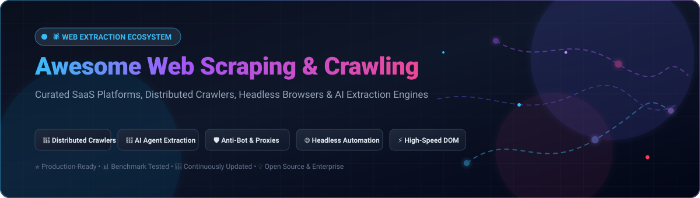

  

# 🕷️ Awesome Web Scraping & Crawling Frameworks 🚀

     

**A comprehensively curated directory of production-grade SaaS platforms, open-source crawlers, browser automation engines, proxy networks, and AI-powered web data extraction frameworks.**

[Explore SaaS](#-saashosted-platforms) • [Open-Source Tools](#-open-source-github-projects) • [Market Dynamics](#-sector-overview--market-dynamics) • [Contributing](#-how-to-contribute) • [Support](#-support)

---

## 📌 Introduction & Scope

Welcome to the **Awesome Web Scraping & Crawling Frameworks** ecosystem tracker! 🌐 Whether you are an AI engineer gathering training sets for Large Language Models (LLMs), a data scientist building Retrieval-Augmented Generation (RAG) pipelines, or a backend engineer orchestrating distributed web spiders, this guide catalogs the premier cloud platforms and battle-tested open-source repositories.

From headless browser orchestration (Playwright, Puppeteer, Camoufox) and anti-bot bypassing (Cloudflare Turnstile, Akamai, Datadome, Kasada evasion) to autonomous LLM browsing agents (Browser-Use, ScrapeGraphAI) and distributed streaming crawlers (Scrapy, Crawlee, Apache Nutch), find the optimal tool for your web extraction stack.

---

## 📑 Table of Contents

- [📊 Sector Overview & Market Dynamics](#-sector-overview--market-dynamics)
- [🏢 SaaS/Hosted Platforms](#-saashosted-platforms)
- [💻 Open-Source GitHub Projects](#-open-source-github-projects)
  - [⭐ Ranked Open-Source Frameworks](#-ranked-open-source-frameworks)
  - [🛠️ Additional Specialized Scraping Libraries](#️-additional-specialized-scraping-libraries)
- [📈 Star History](#-star-history)
- [🤝 How to Contribute](#-how-to-contribute)
- [💖 Support](#-support)
- [⚖️ Disclaimer](#️-disclaimer)

---

## 📊 Sector Overview & Market Dynamics

The global web scraping software, proxy infrastructure, and automated web data extraction market is valued at approximately **$1.34B to $1.56B**, projected to surpass **$4.0B+** with a robust **CAGR of 17.5%–18.2%**, accelerated significantly by the exponential demand for LLM training data and real-time enterprise AI retrieval (RAG). 

The sector is **moderately to highly fragmented** rather than a winner-take-all monopoly: while top-tier proxy and compliance infrastructure giants like Oxylabs and Bright Data command substantial enterprise market share, persistent anti-bot defenses (Cloudflare, Akamai, DataDome) and specialized niches have fostered a vibrant, competitive ecosystem of agile managed scraper APIs, developer-first micro-platforms, and high-velocity open-source agent frameworks.

---

## 🏢 SaaS/Hosted Platforms

The following table compares leading managed cloud web scraping APIs, enterprise proxy networks, and cloud spider platforms, sorted in descending order by estimated company valuation / annualized revenue scale:

| Platform 🌐 | Starting Price 💳 | Free Tier / Trial Limit 🎁 | Scale / Valuation / ARR 📈 | Core Highlights 🔍 |
| :--- | :--- | :--- | :--- | :--- |
| **[Oxylabs](https://oxylabs.io)** | **$30.00/mo** (Starter 5GB) or $8.00/GB Pay-As-You-Go | **7-day free trial** for businesses or **$5 welcome credit** on registration | **$3.6B Valuation** (~$350M ARR) | Tier-1 global residential proxy network, Web Unblocker with ML heuristic bypass, and enterprise SERP APIs. |
| **[Bright Data](https://brightdata.com)** | **$8.00/GB** Pay-As-You-Go or $0.60/GB for Datacenter | **5,000 free API credits/mo** (recurring forever; hard-stop, no CC needed) | **>$1.0B Valuation** (>$300M ARR) | Massive enterprise residential IP pool (72M+ IPs), automated Web Unlocker, and managed Scraping Browser clusters. |
| **[Scrapy Cloud (Zyte)](https://zyte.com)** | **$9.00/unit/mo** (Scrapy Cloud) or $0.13/1k requests (Zyte API) | **1 low-resource unit free forever** (1h runtime/job, 1 concurrent crawl) & $5 Zyte API credit | **~$20M–$25M ARR** (Created Scrapy framework) | Managed spider execution, automatic IP rotation, headless ban management, and automated extraction heuristics. |
| **[Apify](https://apify.com)** | **$19.00/mo** (Starter tier with 64GB RAM) | **$5 free platform credits/mo** (recurring forever; 25 Compute Units, no CC needed) | **~$13M–$14M ARR** (~$3.5M VC funding) | Serverless cloud execution for web scrapers (Actors), marketplace of 1,500+ prebuilt integrations, and scheduler. |
| **[Diffbot](https://diffbot.com)** | **$299.00/mo** (Startup plan, 250,000 credits) | **10,000 credits/mo free forever** (Extract API, NLP & Knowledge Graph access, no CC needed) | **~$50M–$100M Valuation** (~$13M funding, ~$4M ARR) | AI computer vision and NLP-based page synthesis transforming unstructured DOMs into autonomous knowledge graphs. |
| **[ScraperAPI](https://scraperapi.com)** | **$49.00/mo** (Hobby plan, 100,000 credits) | **1,000 API credits/mo free forever** (5 concurrency limit) + 7-day 5,000 credit trial | **Acquired by SaaS.group** (Estimated >$5M ARR) | Streamlined developer API managing IP rotation, residential routing, CAPTCHA bypass, and headless Chrome rendering. |
| **[ScrapingBee](https://www.scrapingbee.com/)** | **$19.00/mo** (Hobby plan, 75,000 credits) | **1,000 free API credits trial** (Full feature access, no credit card required) | **Acquired for 8-figure sum by Oxylabs** (~$5M ARR exit) | Clean REST API handling JavaScript rendering via headless Chrome, proxy rotation, and screenshot/markdown extraction. |
| **[Smartproxy](https://smartproxy.com)** | **$11.25/mo** (3GB Starter pack) or $4.00/GB Pay-As-You-Go | **3-day free trial** with 100MB residential proxy traffic (No credit card required upfront) | **Bootstrapped Scale-up** (Acquired SERPMaster, est. $5M–$10M+ ARR) | High-speed residential proxy network (65M+ IPs), site unblocker API, and e-commerce scraping endpoints. |
| **[Crawlbase](https://crawlbase.com)** | **Pay-As-You-Go** ($0 monthly sub, $1.10/1k requests) or $99/mo | **1,000 free requests trial** (No credit card required upon onboarding) | **Bootstrapped** (Estimated ~$2.9M ARR) | High-concurrency crawling backend, asynchronous scraping API, smart proxy storage queues, and cloud web unlocker. |
| **[WebScraping.AI](https://webscraping.ai)** | **$29.00/mo** (250,000 API credits) | **2,000 API credits/mo free forever** (No credit card required) | **Private Bootstrapped** (<$2M ARR) | Lightweight developer API combining rotating proxies, headless browser execution, and built-in LLM parsing endpoints. |

---

## 💻 Open-Source GitHub Projects

### ⭐ Ranked Open-Source Frameworks

All open-source repositories below are ranked strictly by **GitHub_Stars_Count (descending)**, featuring social Stars_Badges linking directly to each repository's stargazers community:

1. **[Firecrawl](https://github.com/firecrawl/firecrawl)**   
   Turn entire websites into clean Markdown or structured JSON for LLM applications with automatic recursive crawling and dynamic JavaScript execution.
2. **[Browser-Use](https://github.com/browser-use/browser-use)**   
   Cutting-edge open-source framework enabling autonomous AI agents to interact with web browsers, click elements, solve forms, and extract deep page data.
3. **[Scrapling](https://github.com/D4Vinci/Scrapling)**   
   Adaptive, undetectable Python web scraping framework offering TLS-fingerprinted HTTP fetchers, stealth browser drivers, and Model Context Protocol (MCP) server integration.
4. **[Playwright](https://github.com/microsoft/playwright)**   
   Fast, reliable cross-browser automation and web crawling framework for Chromium, Firefox, and WebKit supporting Python, Node.js, Java, and .NET.
5. **[Puppeteer](https://github.com/puppeteer/puppeteer)**   
   High-level Node.js library to control headless Chrome or Chromium over the DevTools Protocol, ideal for DOM scraping and PDF/screenshot generation.
6. **[Crawl4AI](https://github.com/unclecode/crawl4ai)**   
   Asynchronous, high-speed Python web crawler engineered specifically for LLMs, generating clean Markdown, chunked text, and structured JSON schemas.
7. **[Scrapy](https://github.com/scrapy/scrapy)**   
   The industry-standard, high-speed asynchronous Python web scraping and web crawling framework equipped with rich middleware and pipeline ecosystems.
8. **[Huginn](https://github.com/huginn/huginn)**   
   Self-hosted agent workflow system that reads the web, watches for DOM/page updates, parses content, and triggers autonomous automated scraping pipelines.
9. **[Changedetection.io](https://github.com/dgtlmoon/changedetection.io)**   
   Self-hosted website change monitoring, DOM mutation tracking, and visual web scraping tool with Playwright integration and webhook notifications.
10. **[ScrapeGraphAI](https://github.com/ScrapeGraphAI/Scrapegraph-ai)**   
    Python web scraping library using Large Language Models and graph logic to automatically extract structured schemas without writing fragile CSS selectors.
11. **[Crawlee](https://github.com/apify/crawlee)**   
    Production-grade web scraping and browser automation library for Python and Node.js featuring automatic proxy rotation, autoscaling, and queue management.
12. **[Colly](https://github.com/gocolly/colly)**   
    Lightning-fast, elegant scraping and crawling framework for Go capable of handling thousands of requests per second with automatic cookie and session handling.
13. **[Maxun](https://github.com/getmaxun/maxun)**   
    Open-source, no-code web scraper with an interactive web UI to visually click, train extraction schemas, run custom spiders, and set scheduled tasks.
14. **[Katana](https://github.com/projectdiscovery/katana)**   
    Next-generation web crawling and spidering framework built in Go supporting both high-speed headless browser rendering and standard HTTP crawling.
15. **[PySpider](https://github.com/binux/pyspider)**   
    Full-featured web crawler architecture with web UI code editor, task monitor, job scheduler, and distributed worker execution.
16. **[Newspaper4k](https://github.com/codelucas/newspaper)**   
    Full-text article scraping, news extraction, and metadata parsing library for Python with multi-language NLP tokenization.
17. **[Camoufox](https://github.com/daijro/camoufox)**   
    Anti-detect browser engine built on Firefox that spoof hardware fingerprints, WebRTC, and canvas metrics to bypass sophisticated anti-bot systems.
18. **[SeleniumBase](https://github.com/seleniumbase/SeleniumBase)**   
    All-in-one Python framework for browser automation and web scraping with UC Mode (Undetected-ChromeDriver) to seamlessly navigate past CAPTCHA challenges.
19. **[Datasette](https://github.com/simonw/datasette)**   
    An open-source multi-tool for exploring, querying, and publishing structured datasets produced by web scraping and crawling pipelines.
20. **[Feroxbuster](https://github.com/epi052/feroxbuster)**   
    Fast, recursive content discovery and multi-threaded web crawler written in Rust designed for rapid directory traversal and resource extraction.
21. **[Trafilatura](https://github.com/adbar/trafilatura)**   
    High-performance Python library and CLI tool designed for scraping main web text, article bodies, comments, and metadata without boilerplate noise.
22. **[Node-Crawler](https://github.com/bda-research/node-crawler)**   
    Production-ready Node.js web crawler featuring priority task queues, rate limiting, connection pooling, and Cheerio DOM parsing.
23. **[Nodriver](https://github.com/ultrafunkamsterdam/nodriver)**   
    The async successor to Undetected-Chromedriver: drives Chrome directly via DevTools Protocol without `chromedriver` binaries, preventing bot-detection flags.
24. **[Heritrix](https://github.com/internetarchive/heritrix3)**   
    The Internet Archive's web-scale, archival-grade open-source web crawler engineered for broad, multi-terabyte web archiving missions.
25. **[Apache Nutch](https://github.com/apache/nutch)**   
    Enterprise-scale, highly modular web crawler built on Apache Hadoop for massive distributed crawling and Solr/Elasticsearch ingestion.
26. **[Spider](https://github.com/spider-rs/spider)**   
    Blazing fast, concurrent web crawler and scraping engine written in Rust featuring decentralized multi-threading and headless Chrome integration.
27. **[Frontera](https://github.com/scrapinghub/frontera)**   
    Distributed crawl frontier framework designed by Zyte to scale Scrapy across large multi-worker server clusters with custom crawling policies.
28. **[thClaws](https://github.com/thClaws/thClaws)**   
    Native Rust AI agent harness providing scheduled background extraction jobs, headless browser workflows, and MCP server connectivity.
29. **[Apache StormCrawler](https://github.com/apache/stormcrawler)**   
    Open-source SDK for building scalable, low-latency stream-based web crawlers on top of Apache Storm for real-time extraction streams.

---

### 🛠️ Additional Specialized Scraping Libraries

- **⚡ High-Speed Parsers**: [lxml](https://github.com/lxml/lxml) (C-based XML/HTML parser for Python), [selectolax](https://github.com/rushter/selectolax) (Fast Modest/Lexbor HTML parser), [BeautifulSoup](https://www.crummy.com/software/BeautifulSoup/) (Pythonic idioms for DOM navigation), [Cheerio](https://github.com/cheeriojs/cheerio) (Fast, flexible DOM scraping for Node.js), and [goquery](https://github.com/PuerkitoBio/goquery) (jQuery-style syntax for Go).
- **🧹 Boilerplate Extractors**: [readability-lxml](https://github.com/buriy/python-readability) (Python port of Mozilla Readability) and [Goose3](https://github.com/goose3/goose3) (Article extractor in Python).
- **🤖 Browser Driver Stealth**: [puppeteer-extra-plugin-stealth](https://github.com/berstend/puppeteer-extra) (Evasion plugins for Puppeteer) and [playwright-stealth](https://github.com/AtuboDad/playwright_stealth).

---

## 📈 Star History

  

---

## 🤝 How to Contribute

Contributions are wholeheartedly appreciated! 🎉 To contribute:

1. **Fork** this repository. 🍴
2. **Add or enhance** tools in `README.md` maintaining proper alphabetical or star-ranked order. 📝
3. Provide: Name, direct URL, Stars_Badge link, concise descriptive summary, and category tags. 🏷️
4. Submit a **Pull Request** detailing your changes. 🚀

---

## 💖 Support

A massive **Thank You** 🙏 to all developers, data engineers, and AI pioneers building open-source scrapers and sharing their tools with the community!

If this curated directory has helped you discover tools, save development hours, or scale your web crawling pipelines, please consider supporting the project:

- ⭐ **Star** this repository on GitHub!
- 🍴 **Fork & Share** it with your developer networks, Slack communities, and Discord groups.
- ☕ **Buy a Coffee / Sponsor**: Support ongoing maintenance through the [GitHub Sponsor Dashboard](https://github.com/sponsors/ishandutta2007).

---

## ⚖️ Disclaimer

- This list is **community-curated** for educational, analytical, and developmental purposes.
- Always ensure web crawling and data harvesting activities strictly adhere to target site `robots.txt`, Terms of Service (ToS), and relevant global data privacy regulations (e.g., GDPR, CCPA).
- Exercise responsible web crawling: enforce polite request pacing, honor server headers, utilize rotating proxies ethically, and avoid overwhelming origin hosts.

---

Made with ❤️ by [Ishan Dutta](https://github.com/ishandutta2007) and the Open-Source Community.

